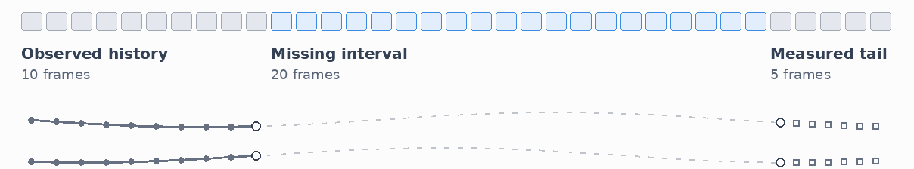
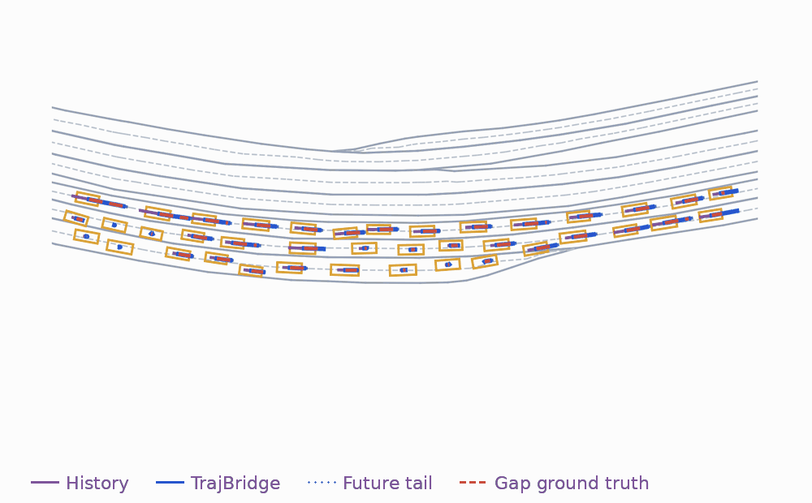
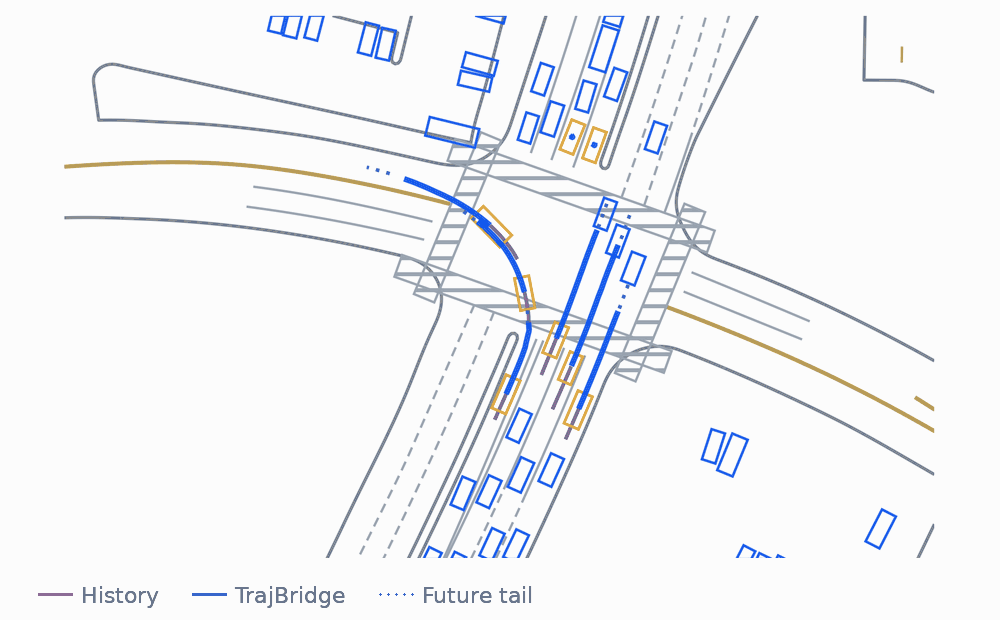
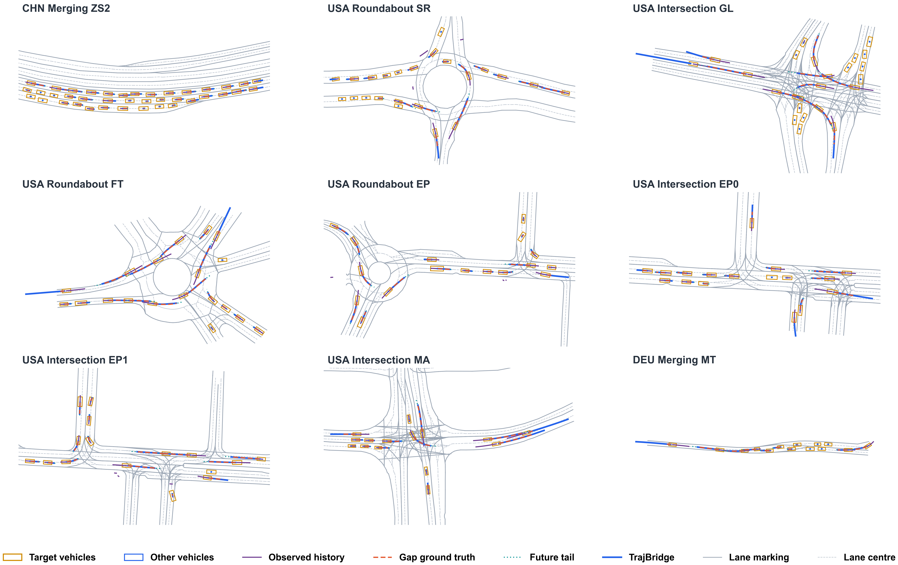
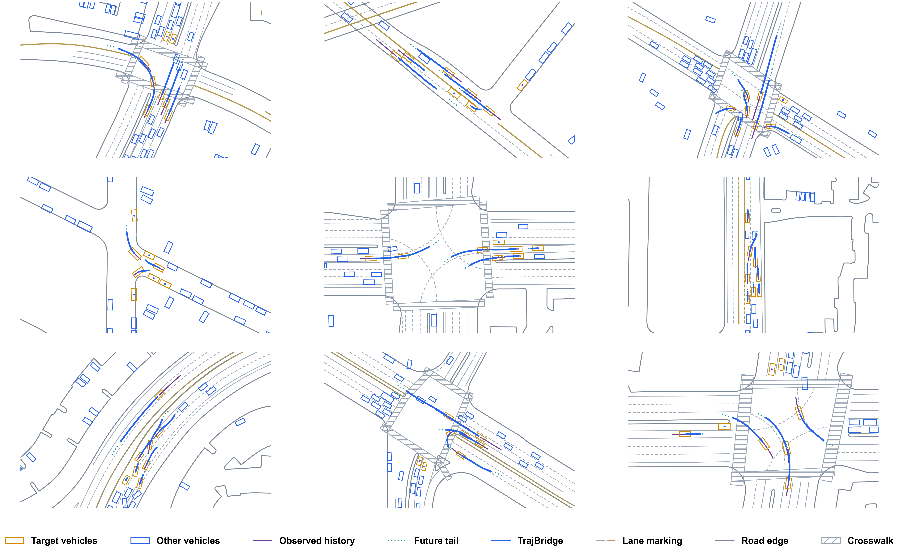

<h1 align="center">TrajBridge: Future-Constrained Conditional Flow Bridge for Multi-Agent Trajectory Reconstruction in Dense Traffic</h1>

<p align="center">
  <a href="https://pytorch.org/">
    
  </a>
  <a href="https://www.python.org/">
    
  </a>
  <a href="https://developer.nvidia.com/cuda-toolkit">
    
  </a>
  <a href="LICENSE">
    
  </a>
</p>

<p align="center">
  
</p>


## ✨ Highlights

<table>
  <tr>
    <td width="50%"><strong>↔️ Two-sided reconstruction</strong><br>Observed history and a measured future tail constrain the missing interval from both sides.</td>
    <td width="50%"><strong>🚘 Interaction-aware motion priors</strong><br>Factorized agent, temporal, and mode attention produces multiple joint trajectory hypotheses.</td>
  </tr>
  <tr>
    <td><strong>🌊 Conditional flow refinement</strong><br>A future-tail-conditioned vector field progressively refines the trajectory priors.</td>
    <td><strong>🌍 Cross-dataset evaluation</strong><br>The manuscript studies INTERACTION reconstruction and zero-shot transfer to 500 Waymo scenes.</td>
  </tr>
</table>

## Contents

- [🎞️ Reconstruction task](#reconstruction-task)
- [🛠️ Getting started](#getting-started)
- [🚀 Training](#training)
- [🔎 Validation](#validation)
- [🚘 Qualitative Gallery](#qualitative-gallery)
- [🙏 Acknowledgements](#acknowledgements)

<a id="reconstruction-task"></a>

## 🎞️ Reconstruction task

<p align="center">
  <picture>
    <source media="(prefers-reduced-motion: reduce)" srcset="assets/readme/task-window.png">
    
  </picture>
</p>


<a id="getting-started"></a>

## 🛠️ Getting started

### 1. Environment Setup

Clone the repository and set up the environment:

```bash
git clone https://github.com/Nova-chen151/TrajBridge.git
cd TrajBridge
conda env create -f environment.yml
conda activate trajbridge
```

### 2. Dataset

Download the [INTERACTION Dataset v1.2](https://interaction-dataset.com/). Here, we only need the data for the multi-agent tracks. After downloading and extracting the zip files, organize the dataset directory as follows:

```
/path/to/INTERACTION_root/
├── maps/
├── test_conditional-multi-agent/
├── test_multi-agent/
├── train/
│   ├── DR_CHN_Merging_ZS0_train
│   ├── ...
└── val/
    ├── DR_CHN_Merging_ZS0_val
    ├── ...

```

Install the map dependency [lanelet2](https://github.com/fzi-forschungszentrum-informatik/Lanelet2):
```
pip install lanelet2==1.2.1
```

<a id="training"></a>

## 🚀 Training

```bash
python train.py --root /path/to/INTERACTION_ROOT --train_batch_size 4 --val_batch_size 4 --devices 1
```

<a id="validation"></a>

## 🔎 Validation

```bash
python val.py --root /path/to/INTERACTION_ROOT --ckpt_path runs/<timestamp>/checkpoints/last.ckpt --val_batch_size 4 --devices 1
```
<a id="qualitative-gallery"></a>

## 🚘 Qualitative Gallery

<table>
  <tr>
    <th width="50%">INTERACTION reconstruction</th>
    <th width="50%">Waymo zero-shot transfer</th>
  </tr>
  <tr>
    <td valign="top">
      <picture>
        <source media="(prefers-reduced-motion: reduce)" srcset="assets/readme/interaction-preview.png">
        
      </picture>
    </td>
    <td valign="top">
      <picture>
        <source media="(prefers-reduced-motion: reduce)" srcset="assets/readme/waymo-preview.png">
        
      </picture>
    </td>
  </tr>
  <tr>
    <td>Dense multi-agent interactions across merging, roundabouts, and intersections.</td>
    <td>Selected qualitative examples from transfer without fine-tuning.</td>
  </tr>
</table>

<details>
<summary><b>Expand: full-resolution INTERACTION figure and legend</b></summary>

<p align="center">
  <a href="assets/readme/interaction-reconstruction.png">
    
  </a>
</p>

</details>

<details>
<summary><b>Expand: full-resolution Waymo figure and legend</b></summary>

<p align="center">
  <a href="assets/readme/waymo-reconstruction.png">
    
  </a>
</p>

</details>

<a id="acknowledgements"></a>

## 🙏 Acknowledgements

We sincerely appreciate [QCNet](https://github.com/ZikangZhou/QCNet) and [HPNet](https://github.com/XiaolongTang23/HPNet) for their awesome codebases.