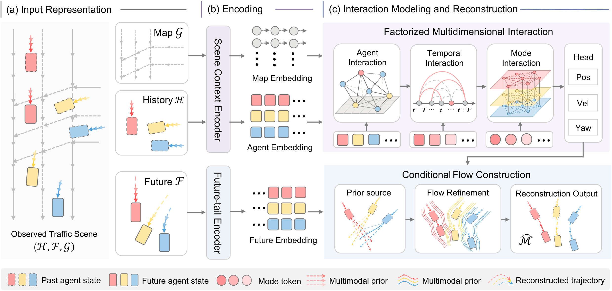

# TrajBridge

TrajBridge is a multi-agent trajectory reconstruction project for the INTERACTION dataset. The repository keeps a single, reproducible training and validation path for the model, with the package layout and command-line workflow organized in the spirit of [QCNet](https://github.com/ZikangZhou/QCNet).

**INTERACTION trajectory reconstruction** · [Getting Started](#getting-started) · [Training](#training) · [Validation](#validation) · [Citation](#citation-and-contact)

## Overview

<p align="center">
  
</p>

The main task is reconstruction. `train.py` builds the `TrajBridge` Lightning module, trains it on the INTERACTION training split, evaluates the validation split during training, and saves checkpoints. `val.py` restores a checkpoint and evaluates the INTERACTION validation split with the same model configuration.

The project description is **Future-Constrained Conditional Flow Bridge for Multi-Agent Trajectory Reconstruction in Dense Traffic**. The current training entry point runs the reconstruction backbone with map encoding. Its configuration disables the flow bridge and posterior bridge, so the included command does not train the conditional flow bridge.

## Repository layout

```text
Trajbridge/
├── train.py                    # training entry point
├── val.py                      # checkpoint validation entry point
├── model/TrajBridge.py         # TrajBridge LightningModule
├── datamodules/                # INTERACTION LightningDataModule
├── datasets/                   # INTERACTION reader and reconstruction masks
├── modules/                    # backbone, map encoder, and bridge modules
├── layers/                     # graph attention and MLP layers
├── losses/                     # training losses
├── metrics/                    # validation metrics
├── transforms/                 # training augmentations
└── utils/                      # geometry and preprocessing utilities
```

## Getting Started

### Environment

The code was checked with Python 3.8 and the following versions.

```text
PyTorch              2.1.0
PyTorch Geometric    2.3.1
PyTorch Lightning    2.0.3
TorchMetrics         1.4.0.post0
```

An example environment setup is shown below. Install a PyTorch build that matches the CUDA version on your machine.

```bash
conda create -n trajbridge python=3.8
conda activate trajbridge
conda install pytorch==2.1.0 torchvision==0.16.0 torchaudio==2.1.0 pytorch-cuda=12.1 -c pytorch -c nvidia
pip install torch_geometric==2.3.1 pytorch-lightning==2.0.3 torchmetrics==1.4.0.post0 numpy pandas tqdm tensorboard
```

### Dataset

Set `--root` to the INTERACTION data root. The reader accepts raw files and prepared tensor caches.

```text
INTERACTION_ROOT/
├── train/                     # raw training CSV files
├── val/                       # raw validation CSV files
├── maps/                      # Lanelet2 OSM maps
├── train_processed/           # prepared .pt files
└── val_processed/             # prepared .pt files
```

Raw preprocessing requires the Lanelet2 Python bindings and corresponding OSM maps. Use `--processed_only true` when compatible processed directories are already available. This reads the prepared tensors directly.

## Training

```bash
python train.py \
  --root /path/to/INTERACTION_ROOT \
  --train_batch_size 4 \
  --val_batch_size 4 \
  --devices 1
```

By default, the run is created under `runs/<timestamp>/`. The trainer saves `last.ckpt` and the checkpoint with the best `val_recon_minJointFDE` under the run's `checkpoints/` directory.

For a quick end-to-end smoke run, use one batch from each split.

```bash
python train.py \
  --root /path/to/INTERACTION_ROOT \
  --processed_only true \
  --train_batch_size 1 \
  --val_batch_size 1 \
  --num_workers 0 \
  --accelerator cpu \
  --devices 1 \
  --max_epochs 1 \
  --limit_train_batches 1 \
  --limit_val_batches 1 \
  --default_root_dir runs/smoke
```

## Validation

Pass a checkpoint produced by `train.py` to `val.py`.

```bash
python val.py \
  --root /path/to/INTERACTION_ROOT \
  --ckpt_path runs/<timestamp>/checkpoints/last.ckpt \
  --val_batch_size 4 \
  --devices 1
```

For a fast validation check, add `--processed_only true --num_workers 0 --limit_val_batches 1`. The validation entry point restores the model hyperparameters from the checkpoint and reads only the `val` split. If training used `--window_protocol fixed_gap --gap_len 20`, pass those same arguments to `val.py` to preserve the evaluation window.

## Closed-loop verification

The following two commands exercise the complete public path from data loading to checkpoint restoration and validation.

```bash
python train.py --root /path/to/INTERACTION_ROOT \
  --processed_only true --train_batch_size 1 --val_batch_size 1 \
  --num_workers 0 --accelerator cpu --devices 1 --max_epochs 1 \
  --limit_train_batches 1 --limit_val_batches 1 --default_root_dir runs/smoke

python val.py --root /path/to/INTERACTION_ROOT \
  --processed_only true --num_workers 0 --accelerator cpu --devices 1 \
  --limit_val_batches 1 --ckpt_path runs/smoke/checkpoints/last.ckpt
```

The smoke path was executed successfully on a prepared INTERACTION cache. It is intended as an integration check, not as a reported benchmark result.

## Reproducibility notes

- Training and validation use checkpoint-defined model horizons. Pass matching `--window_protocol` and `--gap_len` arguments to validation when changing them from their defaults.
- Use `--seed` to control the Lightning and data-loader seed.
- Keep the dataset cache, command-line arguments, checkpoint, and reported metrics together when recording an experiment.
- The repository does not include raw INTERACTION data, processed caches, checkpoints, or TensorBoard output.

## Reference

The directory split and the separation between training and validation entry points follow the public organization of [QCNet](https://github.com/ZikangZhou/QCNet).

## Citation and contact

The paper citation will be added after publication. For questions or reproducibility issues, please open an issue in the [TrajBridge repository](https://github.com/Nova-chen151/TrajBridge).
